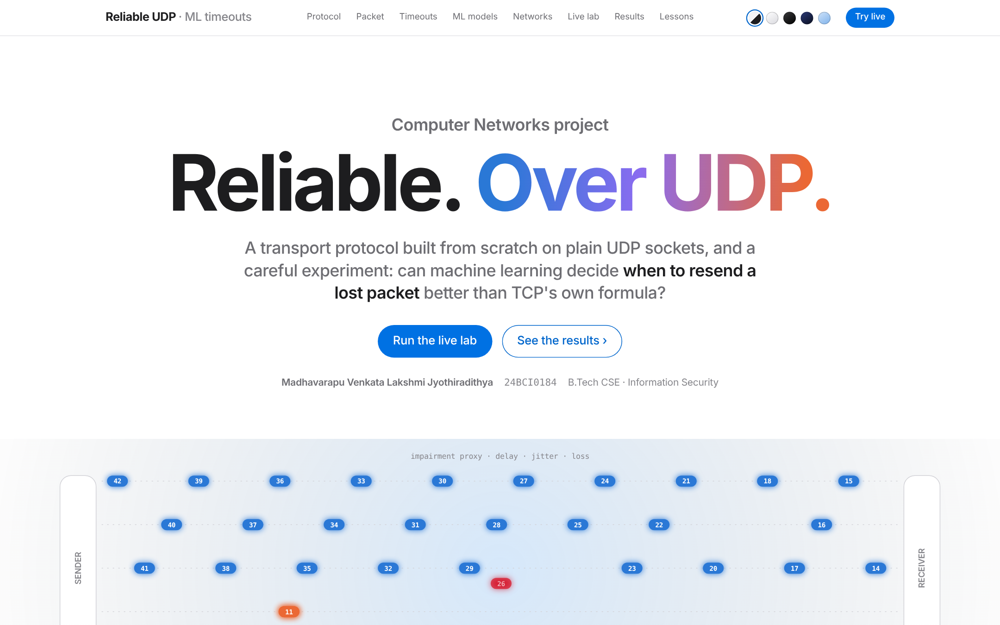
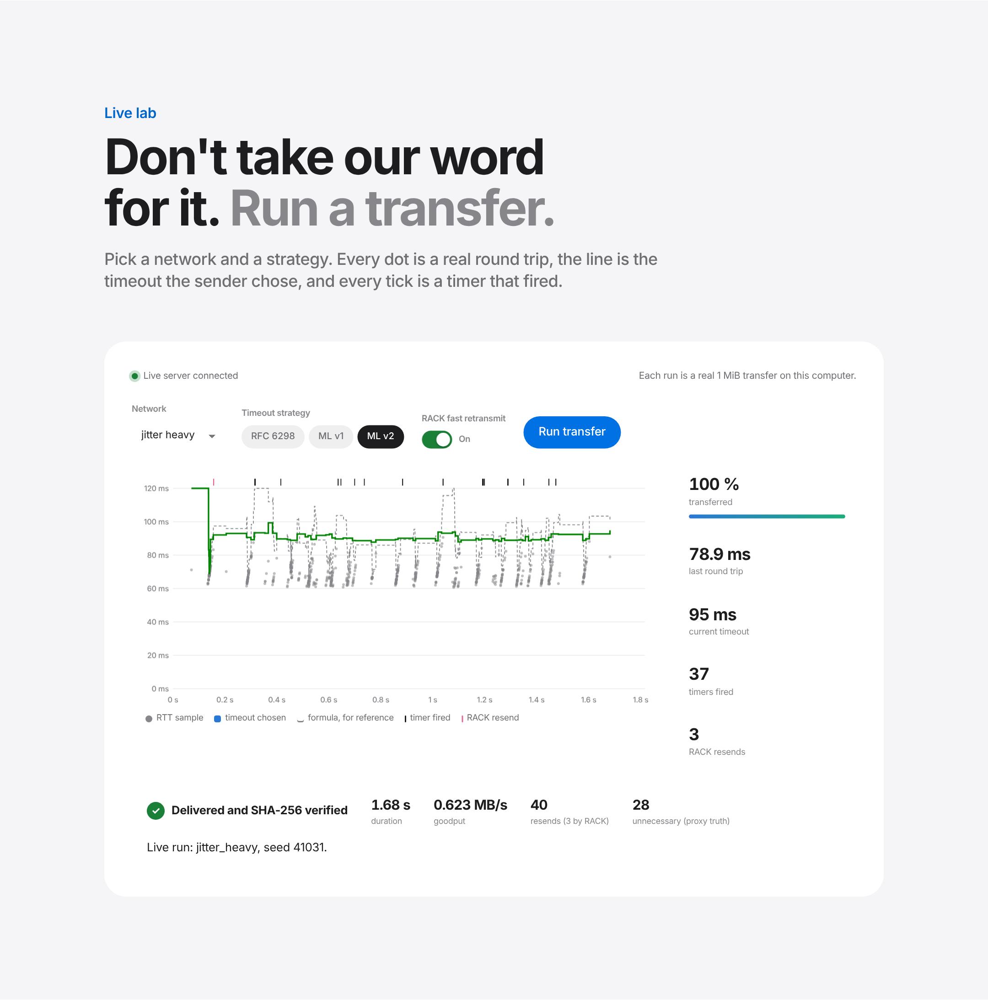
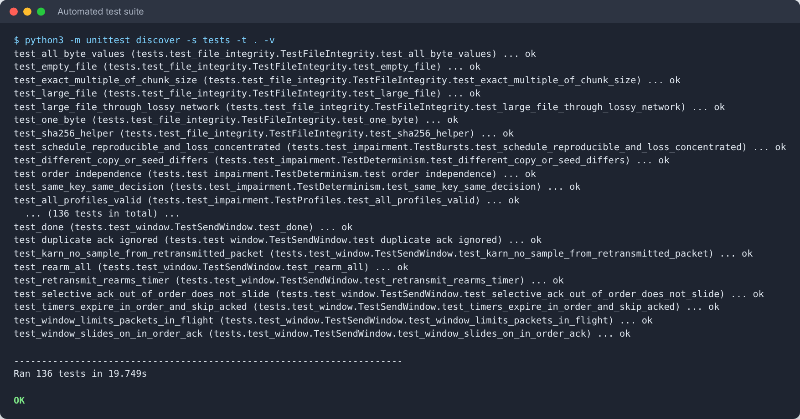
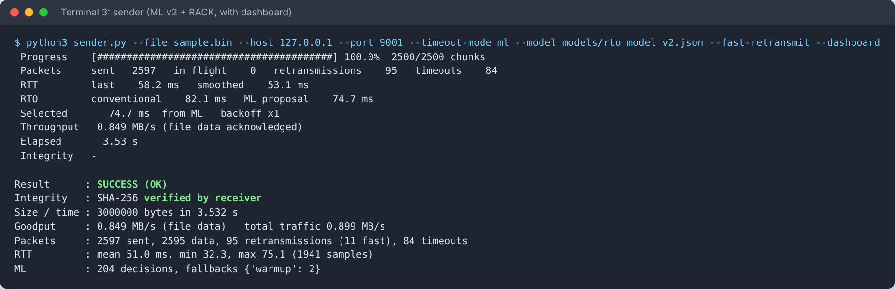
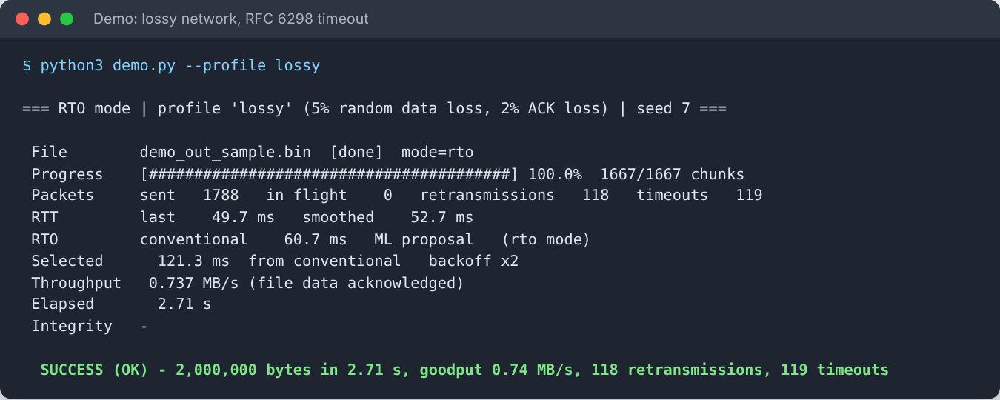
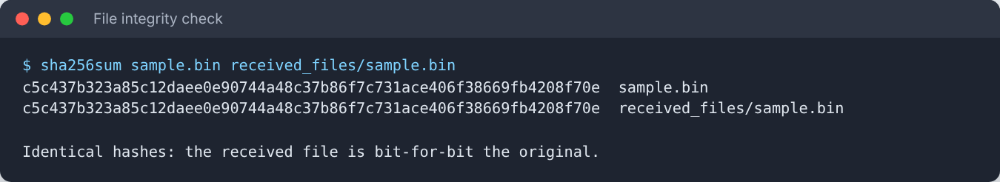
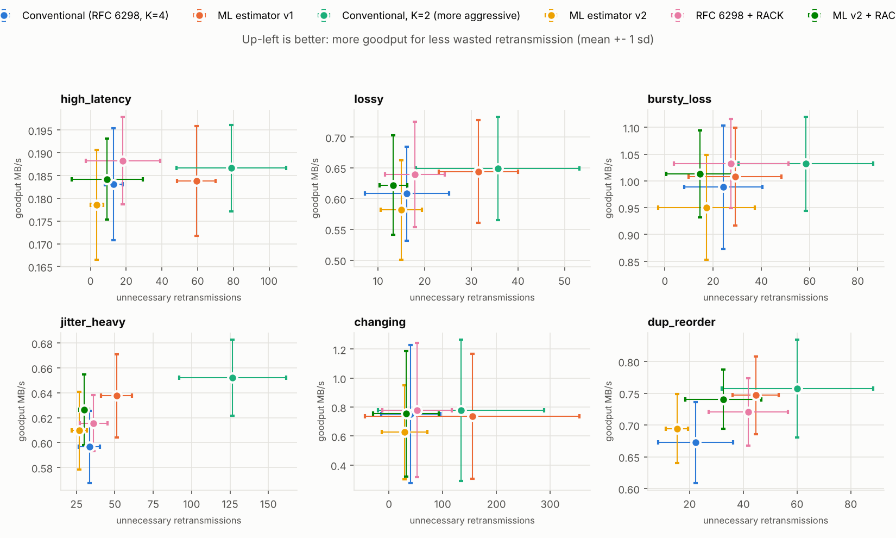

# F1_Team10 · AI-Adaptive Reliable File Transfer over UDP

**Computer Networks project, VIT · Slot F1 · Team 10**

| Team member | Register number |
|---|---|
| Madhavarapu Venkata Lakshmi Jyothiradithya | 24BCI0184 |
| R. Sanjay | 24BCI0181 |

**Full title:** AI-Adaptive Reliable File Transfer Protocol over UDP Using Machine Learning-Based Retransmission Timeout Prediction

## Submission contents

| Item (as required) | Where in this repository |
|---|---|
| Project report (VTOP Assignment 8) | [`submission/F1_Team10_Report.pdf`](submission/F1_Team10_Report.pdf) |
| Project presentation (VTOP Assignment 9) | [`submission/F1_Team10_PPT.pptx`](submission/F1_Team10_PPT.pptx) |
| Complete source code | All folders below; also packed as [`submission/F1_Team10_SourceCode.zip`](submission/F1_Team10_SourceCode.zip) |
| Network simulation files | [`simulation/`](simulation/) and [`proxy.py`](proxy.py): the network is simulated by our own UDP impairment proxy (delay, jitter, loss, bursts, duplication, reordering, corruption), with 8 profiles in [`simulation/profiles.py`](simulation/profiles.py). No Cisco Packet Tracer (`.pkt`) file is used, because the project is a socket program, not a device topology. |
| Dashboard screenshots | [`screenshots/`](screenshots/) (14 images), also packed as [`submission/F1_Team10_Screenshots.zip`](submission/F1_Team10_Screenshots.zip) |
| Configuration, model and data files | [`requirements.txt`](requirements.txt), trained models in [`models/`](models/), training data in [`data/`](data/), experiment results in [`results/`](results/) |
| Testing results | 136 automated tests in [`tests/`](tests/); results of 420 transfers in [`results/RESULTS.md`](results/RESULTS.md) |
| Documentation | [`docs/`](docs/): design, code walkthrough, results discussion |

## Software requirements

- Python 3.9 or newer (tested with 3.9 to 3.13) on macOS or Linux
- Sender, receiver, proxy and the ML model at runtime: Python standard library only
- Training, experiments and plots: NumPy, pandas, scikit-learn, Matplotlib (see `requirements.txt`)
- Developed with Visual Studio Code and Git

## Quick start

```bash
git clone https://github.com/mvljyothu-wq/F1_Team10.git
cd F1_Team10
python3 -m venv .venv && source .venv/bin/activate
pip install -r requirements.txt

python3 -m unittest discover -s tests -t .          # 136 tests, about 20 s
python3 demo.py --profile lossy                     # transfer with live dashboard
python3 demo.py --profile jitter_heavy --compare    # RFC 6298 vs ML on the same network
python3 lab_server.py                               # website + live lab: http://localhost:8000
```

## Screenshots

| | |
|---|---|
|  Project website |  Live lab: a real transfer, SHA-256 verified |
|  All 136 tests pass |  Sender dashboard (ML v2 + RACK) |
|  Lossy network, RFC 6298 |  Sent and received files are identical |

---

## Project overview

Reliable file transfer built on top of plain UDP sockets, with a machine-learning
retransmission-timeout (RTO) estimator compared against the standard TCP
estimator (RFC 6298) under identical, reproducible network conditions.

- **Reliability layer:** Selective Repeat sliding window, per-packet timers,
  cumulative + selective ACKs, duplicate and reordering handling, CRC-32 per
  packet, SHA-256 of the whole file, atomic file commit.
- **Two timeout strategies:** RFC 6298 (Jacobson/Karels + Karn + exponential
  backoff) and a Random Forest that predicts the 95th percentile of near-future
  RTTs, wrapped in a safety policy with automatic fallback.
- **Network simulator:** a UDP proxy that adds delay, jitter, random and burst
  loss, duplication, reordering, corruption and delayed ACKs - deterministically,
  so both strategies face the same network.
- **Evaluation:** paired trials across 7 network profiles, exact Wilcoxon tests,
  plots and a generated results table.
- **Security-minded:** strict input validation, safe filenames, bounded memory,
  no pickle (the model is JSON), optional HMAC-SHA256 packet authentication.

> This is an academic protocol for studying reliability and timeout estimation.
> It is **not** a replacement for production transfer protocols (TCP, QUIC,
> SFTP): it has no congestion control and no encryption.

## Results at a glance

**420 transfers** of 1 MiB (7 network profiles × 10 seeds × 6 strategies). All
succeeded and every file was SHA-256-verified. Full tables: [`results/RESULTS.md`](results/RESULTS.md);
interpretation: [`docs/RESULTS_DISCUSSION.md`](docs/RESULTS_DISCUSSION.md).

Averages over the six lossy networks, relative to RFC 6298:

| Strategy | Goodput | Unnecessary resends |
|---|---|---|
| ML v1 (random forest) | +4.6 % | 2.47× |
| RFC with K = 2 (a shorter formula) | +6.6 % | 3.30× |
| ML v2 (quantile boosting, recalibrated) | −2.2 % | 0.71× |
| RFC + RACK loss detection (RFC 8985) | +4.9 % | 1.30× |
| **ML v2 + RACK** | **+4.3 %** | **0.88×** |

- A learned timeout on its own trades speed against waste: v1 is faster but
  wasteful (and a shorter formula does the same); v2 is lean but slower.
- RACK, a protocol fix with no ML, is faster on every lossy network.
- **ML v2 + RACK is the only strategy that is both faster and less wasteful
  than TCP's formula.**



---

## Documentation

| Document | Contents |
|---|---|
| [`docs/site/index.html`](docs/site/index.html) | The project website (open with `python3 lab_server.py` for the live lab) |
| [`docs/DESIGN.md`](docs/DESIGN.md) | Architecture, packet format, protocol, RTO equations, ML formulation, safety policy, fair comparison method, decision log |
| [`docs/CODE_WALKTHROUGH.md`](docs/CODE_WALKTHROUGH.md) | Guided tour of the code, file by file |
| [`docs/RESULTS_DISCUSSION.md`](docs/RESULTS_DISCUSSION.md) | What the experiments show, and why |
| [`docs/VIVA_QA.md`](docs/VIVA_QA.md) | Likely viva questions with answers |
| [`docs/REPORT_AND_PRESENTATION.md`](docs/REPORT_AND_PRESENTATION.md) | Report structure, presentation outline, demo script |
| [`PROJECT_BRIEF.md`](PROJECT_BRIEF.md) | The original requirements |

---

## Setup (macOS / Linux)

Requires Python 3.9 or newer.

```bash
cd F1_Team10
python3 -m venv .venv
source .venv/bin/activate
pip install -r requirements.txt
```

The sender, receiver, proxy and the ML model at runtime need **only the Python
standard library**. NumPy, pandas, scikit-learn and Matplotlib are needed only
for training, experiments and plots.

## The website and live lab

```bash
python3 lab_server.py          # then open http://localhost:8000
```

Serves the project website and lets you start real transfers from the browser:
pick a network, a timeout strategy (RFC 6298, ML v1, ML v2) and RACK on or off,
and watch every round trip, timeout and resend arrive live. The published copy
of the page cannot reach your computer, so there the lab replays recorded runs.

## Quick demo (one command)

```bash
python3 demo.py                                    # lossy network, conventional RTO, live dashboard
python3 demo.py --profile changing --timeout-mode ml
python3 demo.py --profile jitter_heavy --compare   # both strategies on the same network seed
python3 proxy.py --list-profiles                   # what each profile simulates
```

## Running the parts by hand (three terminals)

```bash
# 1. receiver
python3 receiver.py --host 0.0.0.0 --port 9000 --output-dir received_files

# 2. (optional) impairment proxy: sender -> 9001 -> proxy -> 9000 -> receiver
python3 proxy.py --listen-port 9001 --target-port 9000 --profile lossy --seed 1 --status

# 3. sender (use --port 9000 to skip the proxy)
python3 sender.py --file sample.pdf --host 127.0.0.1 --port 9001 --timeout-mode rto --dashboard
python3 sender.py --file sample.pdf --host 127.0.0.1 --port 9001 --timeout-mode ml  --dashboard
```

Useful sender options: `--fast-retransmit` (RACK), `--model models/rto_model_v2.json`,
`--payload-size` (max 1200), `--window`, `--rto-min`,
`--rto-max`, `--rto-initial`, `--max-retries`, `--model`, `--obs-log trace.csv`,
`--json-out result.json`, `--key-file`, `--log-level`. Run any program with
`--help` for the full list.

Between two computers: run the receiver with `--host 0.0.0.0` on one machine and
point the sender at its IP address (allow UDP port 9000 through the firewall).

### Optional packet authentication (HMAC)

```bash
python3 -c "import secrets; print(secrets.token_hex(32))" > psk.key   # share securely
python3 receiver.py --key-file psk.key
python3 sender.py --file sample.pdf --key-file psk.key
```

Keys are read from a file, never from the command line (command lines are
visible to other users via `ps`).

## Tests

```bash
python3 -m unittest discover -s tests -t . -v     # standard library only
pytest -v                                          # same tests, if pytest is installed
```

The suite covers packet encoding/validation (including fuzzing and every
single-bit flip), the window logic, RTO equations and backoff, ML fallback and
safety bounds, model-file validation, the simulator's determinism, and
end-to-end transfers under loss, bursts, duplication, reordering, corruption,
jitter, empty/large/binary files, receiver crashes, idle senders, hash
mismatches, path-traversal attempts and HMAC.

## Reproducing the ML pipeline and the experiments

```bash
python3 -m training.generate_dataset          # ~224 transfers, ~10 min -> data/
python3 -m training.train_model               # -> models/rto_model.json
python3 -m training.train_model --exclude-profile changing --out models/rto_model_lopo_changing.json
python3 -m training.evaluate_model --lopo-model models/rto_model_lopo_changing.json
python3 -m experiments.run_experiments --modes rto ml rto_k2      # ~15 min -> results/trials.csv
# ML v2: second data round under v1 control, train, calibrate end to end
python3 -m training.generate_dataset --mode ml --tag mlctl --test-seeds 0
python3 -m training.train_model_v2            # -> models/v2_candidates/
python3 -m training.calibrate_v2              # -> models/rto_model_v2.json
python3 -m experiments.run_experiments --modes ml_v2 rto_rack ml_v2_rack --resume
python3 -m experiments.report                 # -> results/RESULTS.md and results/plots/
python3 docs/site/build_data.py && python3 docs/site/build.py      # website data
```

Timing-based results depend on the machine; rerunning gives similar but not
identical numbers. Seeds are recorded in every output file.

## Project structure

```
F1_Team10/
├── submission/            report (PDF), presentation (PPTX), source-code and screenshot zips
├── screenshots/           screenshots of the dashboards, live lab, tests and transfers
├── sender.py  receiver.py  proxy.py  demo.py     command-line programs
├── lab_server.py          website + live lab (stdlib HTTP + Server-Sent Events)
├── protocol/
│   ├── packet.py          header, encode/decode, CRC-32, HMAC, SYN/status payloads
│   ├── window.py          Selective Repeat window, receive buffer, RACK loss detection
│   └── reliability.py     sender and receiver state machines
├── timeout/
│   ├── conventional.py    RFC 6298 estimator
│   ├── features.py        ML features (shared by training and runtime)
│   ├── ml_estimator.py    JSON forest model, safety policy, fallback
│   └── manager.py         chooses the RTO, Karn-aware backoff
├── simulation/
│   ├── profiles.py        network profiles
│   ├── impairment.py      deterministic per-packet impairment decisions
│   └── proxy_core.py      the UDP impairment proxy + ground-truth statistics
├── training/              generate_dataset, dataset, train_model (v1), train_model_v2,
│                          calibrate_v2, evaluate_model
├── experiments/           harness, run_experiments, metrics, report, plotstyle
├── tests/                 unittest suite
├── docs/                  design, walkthrough, results discussion, viva Q&A, report outline
│   └── site/              the website (page source, data builder, build script)
├── models/                rto_model.json (v1), rto_model_v2.json, LOPO model, v2 candidates
├── results/               trials.csv, RESULTS.md, plots/, traces/
└── data/                  runs.csv + raw training traces
```

## Platform notes

- Works on macOS and Linux (developed on Linux, Python 3.10-3.13).
- The impairment proxy is application-level: it reproduces delay/loss
  statistics but not queueing, bandwidth limits or real router behaviour.
  On Linux you can instead impair a real interface with `tc netem`, e.g.
  `sudo tc qdisc add dev lo root netem delay 25ms 3ms loss 5%`
  (remove with `sudo tc qdisc del dev lo root`), and run the sender straight to
  the receiver. macOS has no netem; use the proxy (or `dnctl`/`pfctl`, not covered).
- On Linux, sending to a closed UDP port produces "connection refused" on the
  next receive; the sender treats this as packet loss.
- Timers rely on the OS scheduler; RTOs below a few milliseconds are not
  reliable in Python, which is one reason `--rto-min` defaults to 30 ms.
