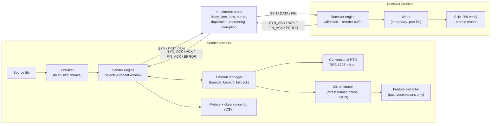

# Design - AI-Adaptive Reliable File Transfer over UDP

Status: implemented (Stages 1-9). Section 15 lists what changed from the first
Stage 1 draft and why. Every number here is a *design choice*; measured results
are in `results/RESULTS.md`.

---

## 1. The project in simple terms

UDP is "fire and forget": a datagram may arrive late, twice, out of order,
corrupted, or not at all, and UDP will not tell you. TCP fixes this inside the
operating system. In this project we fix it **ourselves, in application code,
on top of UDP**:

- the file is cut into numbered chunks;
- the receiver acknowledges (ACKs) every chunk it gets;
- the sender keeps a timer per chunk and resends any chunk whose ACK does not
  come back before the **retransmission timeout (RTO)**.

The interesting question is **how long the sender should wait** before deciding
a packet is lost.

- Too short -> we resend packets that were only delayed (wasted bandwidth,
  "spurious retransmissions").
- Too long -> after a real loss we sit idle (slow recovery, low throughput).

TCP answers this with a formula (Jacobson/Karels, RFC 6298). We implement that
formula as the baseline, train an ML model that looks at recent network history
and proposes an RTO, and measure, on identical network conditions, **when the ML
estimator helps, when it hurts, and why**. "ML is not better here" is an
acceptable result.

---

## 2. Architecture



**Why a separate proxy process for impairment?** It sits where a real network
would be, it is portable (macOS has no `tc netem`), and the sender and receiver
contain no simulation logic, so the same programs can run over a real or
`netem`-impaired link. Limitation: delays are applied in user space on one
machine; there is no queueing, bandwidth limit or router behaviour, and timing
accuracy is limited by OS scheduling (about 1 ms).

| Module | Responsibility |
|---|---|
| `protocol/packet.py` | Header layout, encode/decode, CRC-32, optional HMAC, validation. No sockets. |
| `protocol/window.py` | Send window (in-flight packets, timers, retransmit counts) and receive buffer. No sockets, no clock. |
| `protocol/reliability.py` | Sender and receiver state machines (handshake, data, FIN). |
| `timeout/conventional.py` | SRTT / RTTVAR / RTO. |
| `timeout/features.py` | ML feature vector from the observation history. Shared by training *and* runtime. |
| `timeout/ml_estimator.py` | JSON model loading and validation, pure-Python prediction, safety policy, fallback. |
| `timeout/manager.py` | Chooses the RTO; Karn-aware exponential backoff, identical for both modes. |
| `simulation/` | Profiles, deterministic impairment decisions, the UDP proxy with ground-truth statistics. |
| `training/` | Dataset generation, target construction, training, offline evaluation. |
| `experiments/` | Harness, paired trials, statistics, plots, results table. |
| `sender.py`, `receiver.py`, `proxy.py`, `demo.py` | Command-line programs. |

---

## 3. Choice of reliability protocol: Selective Repeat

| Protocol | Behaviour | Problem for us |
|---|---|---|
| Stop-and-wait | 1 packet in flight | Throughput <= payload / RTT: 1200 B / 300 ms = 4 KB/s. |
| Go-Back-N | N in flight, receiver discards out-of-order packets, one timer | One loss resends the whole window; wastes bandwidth under loss and reordering and hides the effect of the RTO. |
| **Selective Repeat** | N in flight, receiver buffers out-of-order packets, **per-packet timers**, only the missing packet is resent | A buffer of <= N packets at the receiver. |

Selective Repeat keeps the pipe full on high-latency links, tolerates reordering,
and **each retransmission corresponds to one timer decision**, so the effect of
the RTO estimator is measurable per packet.

**ACKs.** One ACK per DATA packet received (including duplicates), carrying
`seq` = the chunk that triggered it (selective) and `ack` = the lowest chunk not
yet received (cumulative). The cumulative field makes lost ACKs harmless.

**RTT samples.** Only from the ACK triggered by the packet itself, and only if
that packet was never retransmitted (Karn). If a later ACK's cumulative field
covers a packet first (its own ACK was overtaken on the reverse path), no sample
is taken: the sender already knows the packet arrived, so that packet's timer
never mattered.

**Sequence numbers.** 32-bit unsigned, counting chunks. Wrap-around would need
a file larger than about 5 TB, so the sender refuses such files instead of
handling wrap-around.

**Flow control.** A fixed window (default 64, negotiated in the SYN, max 4096;
the receiver accepts at most `--max-window`, default 1024). **No congestion
control** - a deliberate scope limit: the protocol is not fair to other traffic
on a shared network.

---

## 4. End-to-end workflow

```mermaid
sequenceDiagram
  participant S as Sender
  participant P as Proxy (impairment)
  participant R as Receiver
  S->>R: SYN (transfer_id, size, chunks, chunk size, window, SHA-256, filename)
  R-->>S: SYN_ACK (accept) - or ERROR (reject, with reason)
  Note over S: SYN retried with backoff, max 8 attempts
  loop while chunks remain
    S->>R: DATA seq=k (up to W packets in flight)
    R-->>S: ACK seq=k, ack=lowest missing
    Note over S: timer expires: resend k, back off,<br/>Karn: no RTT sample from k
  end
  S->>R: FIN
  R->>R: all chunks? running SHA-256 == SYN hash?
  R-->>S: FIN_ACK (OK: file renamed; HASH_MISMATCH / INCOMPLETE: .part deleted)
  Note over S: success only if FIN_ACK status == OK
```

1. **Handshake.** The sender picks a random 32-bit `transfer_id`, computes the
   file's SHA-256 and sends SYN. The receiver validates everything (section 11),
   creates `<name>.<id>.part` exclusively and replies SYN_ACK. A duplicate SYN from
   the same address gets SYN_ACK again; the same ID with different metadata gets
   ERROR.
2. **Data.** Up to `W` unacknowledged chunks in flight. Each stores first-send
   time, last-send time, retransmission count, timer deadline and backoff epoch.
3. **ACK handling.** Mark `seq` and everything below `ack` as acknowledged; slide
   the window; feed a valid RTT sample to the timeout manager.
4. **Timeouts.** The sender blocks on the socket until the earliest deadline (no
   busy-waiting). On expiry the packet is resent and the timeout manager may back
   off (section 6). A packet exceeding `max_retries` (15) aborts the transfer.
5. **Receiver.** Accepts DATA in `[expected, expected + W)` with the exact chunk
   length; writes in-order data immediately and updates a running SHA-256;
   buffers out-of-order data (<= W chunks); re-ACKs duplicates; drops packets
   beyond the window.
6. **Finish.** FIN after every chunk is ACKed. The receiver checks completeness
   and the hash, `fsync`s, atomically renames `.part` to the final name and
   answers FIN_ACK(OK); otherwise FIN_ACK(error) and the partial file is deleted.
7. **Lost FIN_ACK.** Finished transfers linger 5 s; a duplicate FIN gets the
   cached FIN_ACK (like TCP's TIME_WAIT).

| Situation | Behaviour |
|---|---|
| Sender crashes | Receiver idle timeout (30 s) deletes the `.part` file. |
| Receiver crashes | Sender exceeds `max_retries`, exits with an error and non-zero exit code. No resume. |
| ACK lost | A later cumulative ACK covers it, or the packet is resent and re-ACKed. |
| `transfer_id` reused while active | Same metadata from the same address: treated as duplicate SYN. Different metadata: ERROR. From another address: ignored. |
| `transfer_id` of a recently finished transfer | ERROR for 10 minutes (simple replay protection). |
| Packet for unknown `transfer_id` | Dropped and counted. |
| Receiver silent | Sender aborts after 30 s without a valid reply. |

---

## 5. Packet format

Big-endian (`struct` format `!HBBBBHIIII`), **24-byte header**.

| Offset | Size | Field | Meaning |
|---|---|---|---|
| 0 | 2 | `magic` | `0x5255` ("RU") |
| 2 | 1 | `version` | 1 |
| 3 | 1 | `msg_type` | 1 SYN, 2 SYN_ACK, 3 DATA, 4 ACK, 5 FIN, 6 FIN_ACK, 7 ERROR |
| 4 | 1 | `flags` | bit 0 = HMAC tag present; other bits must be 0 |
| 5 | 1 | `reserved` | must be 0 |
| 6 | 2 | `payload_len` | payload bytes (excludes the HMAC tag) |
| 8 | 4 | `transfer_id` | random per transfer |
| 12 | 4 | `seq` | DATA: chunk index. ACK: chunk being acknowledged |
| 16 | 4 | `ack` | ACK: cumulative (lowest chunk not yet received) |
| 20 | 4 | `checksum` | CRC-32 over header (this field = 0) + payload + tag |
| 24 | <=1200 | payload | message-specific |
| 24+len | 16 | tag | optional HMAC-SHA256 (truncated) over header (checksum = 0) + payload |

**Payloads**

- **SYN:** `file_size` (8) · `total_chunks` (4) · `chunk_size` (2) · `window` (2) ·
  `sha256` (32) · `name_len` (1) · `filename` (UTF-8, 1-255 bytes). 49 bytes + name.
- **DATA:** file bytes; exactly `chunk_size`, except the last chunk (the remainder).
- **FIN_ACK / ERROR:** `status` (1): OK, HASH_MISMATCH, INCOMPLETE, REJECTED,
  INTERNAL_ERROR, plus an optional UTF-8 message (<= 200 bytes).
- **SYN_ACK, ACK, FIN:** empty.

**Payload size 1200 bytes.** Largest datagram = 24 + 1200 + 16 = 1240 bytes;
with UDP (8) and IPv4 (20) headers, 1268 bytes - below 1280, the minimum MTU
every IPv6 link supports, and below Ethernet's 1500. So **no IP fragmentation**
(losing one fragment would lose the whole datagram). Header overhead is 2%.
Configurable with `--payload-size` (1-1200).

**Three different integrity checks:**

| Check | Who | Covers | Purpose | Limitation |
|---|---|---|---|---|
| UDP checksum | kernel | UDP header + data | drops corrupted datagrams in transit | 16-bit, optional on IPv4, blind to corruption above UDP (e.g. our proxy) |
| CRC-32 | application, per packet | header + payload + tag | detects accidental corruption | anyone can recompute it |
| SHA-256 | application, whole file | the complete file | proves the file is bit-identical | integrity, not *who* sent it |

None of these authenticates the sender; the optional HMAC does (section 11).

**Decode validation** (reject with `PacketError`, never crash): 24 <= length <=
1240; magic; version; flags in {0, HMAC}; reserved = 0; `payload_len` <= 1200
and consistent with the datagram length; CRC; then HMAC if a key is configured
(an unauthenticated packet is rejected when a key is set, and an authenticated
one when no key is set); then the message type. Sockets read at most 1241
bytes per datagram, so an oversized datagram is detected and rejected.

---

## 6. Conventional RTO (Baseline A) - RFC 6298

For a valid RTT sample `R` (seconds):

```
first sample:   SRTT = R,  RTTVAR = R/2
later samples:  RTTVAR = (1 - beta) * RTTVAR + beta * |SRTT - R|     (old SRTT)
                SRTT   = (1 - alpha) * SRTT  + alpha * R
RTO = clamp(SRTT + max(G, K * RTTVAR), RTO_min, RTO_max)
alpha = 1/8, beta = 1/4, K = 4, G = 1 ms
```

- **SRTT**: exponentially weighted average RTT. **RTTVAR**: smoothed mean
  deviation. **K = 4**: a timeout several deviations above the mean.
- **Before any sample** RTO = 1 s (`--rto-initial`).
- **Karn's algorithm**: no sample from retransmitted packets (DATA, SYN, FIN).
- **Bounds**: `RTO_min` = 30 ms, `RTO_max` = 10 s. *Deliberate deviation*: the
  RFC's 1 s minimum suits the Internet and delayed ACKs; on our 20-300 ms
  simulated paths it would make both estimators output 1 s and hide every
  difference. 30 ms stays well above Python's timer resolution.

**Exponential backoff with per-packet timers (timeout/manager.py).** Each
timeout may double the RTO (`RTO x 2^level`, capped at `RTO_max`); a valid RTT
sample resets the level to 0 (RFC 6298 section 5). With up to 64 timers, one
outage fires many timers at once; doubling for each would jump straight to 10 s.
So the manager keeps a **backoff epoch** that changes whenever the level
changes. Each packet records the epoch in which it was (re)sent, and a timeout
raises the level only if that packet was sent in the current epoch: one doubling
per round of timeouts, like TCP's single timer. When a sample ends a backoff,
all pending timers are re-armed with the new RTO, so no packet keeps a stale,
backed-off timer. Backoff is applied identically in both timeout modes.

---

## 7. ML timeout estimator (Baseline B)

### 7.1 Target

At each **decision point** - an RTT sample arriving at time *t* - the model
predicts:

> **y(t)** = 95th percentile of the RTTs of valid samples whose packets were
> **sent in (t, t + 0.5 s]**.

- An RTO is a threshold. With timeout = P95, about 5% of delivered packets would
  outlive their timer - an explicit spurious-retransmission budget. The mean RTT
  would time out half the packets.
- Non-negative, in seconds, directly comparable with the conventional RTO.
- The future is used **only as the label**, offline. Features come only from the past.
- Rows with fewer than 5 future samples are dropped.
- **Censoring:** lost packets have no RTT, so the target describes how late
  *delivered* packets arrive - which is what an RTO must cover. Loss enters
  through the features.

### 7.2 Direct vs correction

Both formulations are trained and compared on validation runs:

- **correction**: y' = log(y / RTO_conv); RTO = RTO_conv x exp(pred)
- **direct**: y' = log(y); RTO = exp(pred)

Correction is scale-free and keeps the formula as anchor; direct can correct the
formula's systematic bias directly. The candidate (formulation x forest size)
with the lowest validation MAE after margin calibration and the safety policy is
kept; all candidates are recorded in the model file's metadata.

### 7.3 Features (computable at the sender before the decision)

Over the last N = 16 valid RTT samples and the last M = 64 transmissions:

| Feature | Why |
|---|---|
| `log_srtt` | absolute scale |
| `rttvar_rel` = RTTVAR/SRTT | what the formula believes about variability |
| `last_rel`, `mean_rel`, `std_rel`, `p90_rel`, `max_rel`, `min_rel` (each / SRTT) | distribution shape; P90/max capture heavy tails that mean + 4 x var misjudges |
| `slope` | least-squares d(RTT)/dt: is the path getting slower right now? |
| `retx_ratio` | retransmissions among the last 64 sends (lossy periods) |
| `since_timeout_rel` | time since last timeout / SRTT (capped at 1000) |
| `n_samples` | history available (capped at 16) |

**Never** features: true one-way delays, the simulator's loss rate, the profile
name - the sender cannot observe them (leakage). ACK inter-arrival variation was
left out: with one ACK per packet and a window-limited sender it mostly mirrors
RTT jitter, which the RTT statistics already capture.

### 7.4 Data, training, leakage control

- **Generation** (`training/generate_dataset.py`): 7 profiles x 32 seeds of real
  1 MiB transfers with the *conventional* estimator, logging each sample and the
  feature vector at that moment.
- **Split by run, not by row:** seeds 0-19 train, 100-105 validation, 200-205
  test; end-to-end experiments use seeds 1000+. Adjacent rows are nearly
  identical, so a random row split would inflate accuracy.
- **Leave-one-profile-out:** an extra model trained without `changing` and tested
  on it, to measure generalisation to unseen conditions.
- **Model:** `RandomForestRegressor`, 40 trees, max_features 0.6, two sizes
  (depth 8 / leaf 50 and depth 14 / leaf 30), every 3rd training row.
- **Margin:** on validation runs, the smallest m in {1.00, 1.05, ..., 2.00} such
  that the spurious-timeout fraction (after the safety policy) <= max(the
  conventional estimator's fraction, 1%). The ML estimator may be tighter, never
  more spurious than the formula on validation data.
- **Persistence:** JSON (tree arrays + metadata: features, formulation, margin,
  seeds, candidates, importances, scikit-learn version). **No pickle/joblib**:
  unpickling can execute code. The loader checks format, version, feature list
  and every node index (children must follow their parent, so traversal cannot
  loop). `train_model.py` asserts that the pure-Python runtime model reproduces
  scikit-learn's predictions.
- **Covariate shift (limitation):** training data comes from the conventional
  estimator; under ML control features like `retx_ratio` may be distributed
  slightly differently.

### 7.5 Offline training vs online inference

```
OFFLINE (once):     simulate -> log -> features + targets -> train -> models/rto_model.json
ONLINE (per ACK):   history -> features.py -> forest.predict -> safety policy -> RTO
```

The model does not learn during a transfer. Predictions are recomputed when a
sample arrives, at most every 10 ms; timers armed in between reuse the last value.

---

## 8. Timeout decision and safety policy

```
rto_conv = conventional estimator (always updated, both modes)
mode rto: rto = rto_conv
mode ml:  no model / load error          -> rto_conv   (reason "no_model")
          fewer than 8 samples           -> rto_conv   ("warmup")
          prediction raises / NaN / inf  -> rto_conv   ("predict_error" / "invalid_prediction")
          proposal = margin x (rto_conv x exp(p)  or  exp(p))
          rto = clamp(proposal, lo, hi)
            lo = max(RTO_min, 0.5 x rto_conv, largest of the last 16 RTTs)
            hi = min(RTO_max, 2.0 x rto_conv)
both:     final = min(RTO_max, rto x 2^backoff_level)
```

- **Recent-max floor:** never time out sooner than an RTT just observed.
- **[0.5x, 2x] band:** the model refines the formula but cannot go wild on inputs
  unlike its training data.
- **Shared backoff:** differences in results come from estimation, not backoff.
- **Every fallback is counted** and reported with each transfer.

---

## 9. Fair comparison methodology

1. **Paired trials:** for each (profile, seed) both modes send the same 1 MiB file
   with the same impairment seed.
2. **Deterministic impairment per packet copy:** the proxy derives each decision
   from BLAKE2b(seed, direction, type, seq, copy number). With a shared random
   stream, one extra retransmission would shift every later draw and the two runs
   would face different networks. Time-varying profiles depend on time since the
   first packet, plus a per-seed offset into the cycle; the burst schedule is
   generated from the seed up front.
3. **Order alternation:** rto first on even seeds, ml first on odd seeds.
4. **Independence:** 10 seeds per profile (1000-1009), disjoint from model seeds.
   Report means, standard deviations, the paired difference with a 95% bootstrap
   CI, and an exact Wilcoxon signed-rank p-value.
5. **Metrics** (`experiments/metrics.py`): duration; goodput (file bytes /
   duration) vs total traffic rate; packets; retransmissions; timeouts;
   **unnecessary retransmissions** and **loss-recovery delay** from the proxy's
   ground truth; loss rate; SHA-256 (receiver-verified and independently
   re-hashed); sender CPU and peak memory.

---

## 10. Network profiles

One-way delays (RTT ~ 2x). `fwd` = data direction, `rev` = ACK direction.

| Profile | One-way delay | Jitter | Loss fwd / rev | Other |
|---|---|---|---|---|
| `perfect` | 0 | 0 | 0 | demo only |
| `stable` | 10 ms | +-1 ms uniform | 0 | |
| `high_latency` | 150 ms | +-5 ms | 0.5% / 0.5% | |
| `lossy` | 25 ms | +-2.5 ms | 5% / 2% | |
| `bursty_loss` | 25 ms | +-2.5 ms | 0.5% + bad periods with 50% loss (mean 50 ms every ~0.8 s) | |
| `jitter_heavy` | 30 ms | Pareto(alpha=2) x 4 ms, capped 160 ms | 1% / 1% | reordering emerges |
| `changing` | 15 ms -> ramp to 120 ms -> 120 ms -> 30 ms (5 s cycle) | 2-10 ms | 1-3% | steps and ramps |
| `dup_reorder` | 20 ms | +-5 ms | 1% / 1% | 2% duplication, 5% reordered (+15 ms), 1% corruption, ACK delay 0-20 ms |

---

## 11. Security and robustness

- **Input validation** at one boundary (`decode`), fuzz-tested.
- **Filenames:** rejected if empty, > 255 bytes, `.`/`..`, containing `/`, `\` or
  control characters; created with mode `x` inside the output directory (real
  path checked); collisions get ` (1)`.
- **Resource limits:** max file size (1 GiB), max window (1024), max concurrent
  transfers (8), reorder buffer <= window, 1241-byte reads, idle timeout, max
  retries, transfer bound to its source address.
- **No unsafe deserialisation:** network data is parsed with `struct`; the model
  is JSON.
- **Optional HMAC-SHA256** (16-byte tag, pre-shared key >= 16 bytes read from a
  file). Key management is manual. No encryption. Replay: packets are bound to a
  random transfer ID and finished IDs are refused for 10 minutes; full replay
  protection would need nonces/timestamps.
- Not a replacement for TCP, QUIC or SFTP.

---

## 12. Pitfalls designed out

1. RTT from retransmitted packets -> Karn, in one place (`SendWindow.on_ack`).
2. Random row splits -> split by seed.
3. Duplicated feature code -> one `features.py` + feature-list check at load.
4. Sequential RNG in the simulator -> hash-keyed decisions.
5. `time.time()` jumps -> `time.monotonic()` everywhere.
6. Busy-waiting -> socket timeouts set to the next deadline.
7. Success before verification -> only FIN_ACK(OK) is success; the harness re-hashes too.
8. Unbounded memory -> bounded buffers and reads.
9. Path traversal -> filename rejection + exclusive create.
10. Timer resolution -> RTO_min 30 ms.
11. RFC RTO_min of 1 s would hide differences (section 6).
12. Inference cost -> at most one prediction per 10 ms, pure-Python forest.
13. Backoff cascades with per-packet timers -> epochs + re-arming (found by testing; see CODE_WALKTHROUGH 4.3).

---

## 13. Directory structure

See README.md ("Project structure").

---

## 14. Decision log

| # | Decision | Alternatives | Reason |
|---|---|---|---|
| D1 | Selective Repeat, per-packet ACK + cumulative field | Stop-and-wait, Go-Back-N, SACK blocks | Throughput on high RTT; per-packet timer decisions; simpler than SACK lists |
| D2 | 32-bit chunk sequence numbers, no wrap | 16-bit modular | Wrap needs ~5 TB; avoids a class of bugs |
| D3 | 24-byte fixed big-endian header | TLV, JSON | Explicit, fast, easy to validate; JSON/pickle wasteful or unsafe |
| D4 | CRC-32 per packet + SHA-256 per file | SHA-256 per packet | Cheap, sufficient for accidental errors |
| D5 | Payload 1200 B | 1472 B, 512 B | No fragmentation even on IPv6-minimum paths, with HMAC |
| D6 | User-space impairment proxy | impairment inside endpoints; netem only | Portable to macOS; clean protocol code |
| D7 | Hash-keyed impairment | sequential RNG | Fair paired comparisons |
| D8 | Target = P95 of RTTs sent in the next 0.5 s | next RTT; mean | A threshold with an explicit budget |
| D9 | Train direct and correction, keep the better on validation | fix one a priori | The brief asks to evaluate both |
| D10 | Safety band [0.5x, 2x], recent-max floor, shared backoff, fallbacks | unbounded ML | Bounded worst case; fair comparison |
| D11 | RTO_min = 30 ms | RFC 1 s | Otherwise no difference is measurable |
| D12 | Single-threaded loop, deadline-based socket timeout | thread per timer | Deterministic, no locks |
| D13 | Model as JSON + pure-Python inference | joblib/pickle | No code execution on load; no scikit-learn at runtime |
| D14 | Backoff epochs + timer re-arm | per-timeout doubling; level comparison | Level comparison caused runaway RTOs (measured: 22 s vs 4.3 s transfer) |
| D15 | Window field in SYN | fixed window | Receiver can bound its buffer and reject oversized windows |
| D16 | Receiver and proxy as separate processes in experiments | threads | No GIL contention with the sender's timing |
| D17 | RACK (RFC 8985) for fast loss detection, off by default | "3 later ACKs" (dupthresh) rule | dupthresh fired ~3,000 false resends per 1 MiB under per-packet jitter; RACK's time-based rule with an adaptive reordering window does not |
| D18 | ML v2: quantile gradient boosting (pinball loss) | squared-error forest (v1) | Under-prediction costs more than over-prediction; quantile models also widen when the future is uncertain |
| D19 | ML v2 trained on traces from RFC *and* v1-ML control | RFC-only traces | Removes the covariate shift identified in v1 (DAgger-style iteration) |
| D20 | ML v2 margin/quantile chosen end to end on validation transfers | offline early-timeout share | v1 showed that offline metrics did not predict online waste |
| D21 | Live lab: stdlib HTTP server + Server-Sent Events, 127.0.0.1 only | WebSockets, a web framework | No dependencies; one-way event stream is all the page needs |

---

## 15. Version 2 additions

### 15.1 RACK fast loss detection (`protocol/window.py`, `--fast-retransmit`)

Timeouts are the slow path for repairing loss. TCP also detects loss from the
acknowledgement pattern. The first attempt used the classic rule "three packets
sent after P were acknowledged, so P is lost". Under our simulator's per-packet
jitter (which, like Linux netem, reorders packets) it fired about 3,000 false
resends per 1 MiB transfer, so it was replaced by RACK (RFC 8985):

```
RACK.xmit, RACK.rtt = send time and RTT of the most recently SENT packet that was delivered
P is lost  if  P.sent < RACK.xmit  and  now >= P.sent + RACK.rtt + reo_wnd
reo_wnd    = min(reo_mult x min_rtt / 4, RACK.rtt)
```

`reo_mult` grows by one each time a RACK resend turns out to be unnecessary
(its ACK arrives sooner than any real round trip, so it acknowledged the
original copy) and resets after 16 clean repairs. This replaces TCP's DSACK
signal, which our protocol does not have. A pending loss also sets a reorder
timer, so detection does not have to wait for the next ACK. A RACK resend is
not a timeout: there is no backoff, and Karn's rule still applies.

### 15.2 ML estimator v2 (`training/train_model_v2.py`, `training/calibrate_v2.py`)

| v1 problem (measured) | v2 change |
|---|---|
| Squared-error loss treats too-short and too-long timeouts alike | Quantile (pinball) loss at level q: an under-prediction costs q/(1-q) times more |
| Trained only on traces recorded under RFC 6298 (covariate shift) | Adds a second collection round with the v1 model in control (182 transfers) |
| Safety margin chosen offline; online waste doubled | Quantile level and margin chosen on 147 real validation transfers with a rule fixed in advance: waste <= 1.15 x RFC, then highest goodput |

Model: `GradientBoostingRegressor(loss="quantile")`, 300 trees of depth 4,
exported as a "boosting" ensemble (`init + learning_rate x sum of trees`) and
evaluated in pure Python like v1. Same 12 features, same label, same safety
policy, so the comparison isolates the training changes.

### 15.3 Live lab (`lab_server.py`)

`python3 lab_server.py` serves `docs/site/` on 127.0.0.1:8000 and adds
`POST /api/run` (validated against fixed lists, one transfer at a time) and
`GET /api/events?run=<id>`, a Server-Sent Events stream with every RTT sample,
timeout, RACK resend, progress snapshot and the final result plus the proxy's
ground truth. The sender exposes these through an `events` callback that can
never break a transfer (exceptions in observers are caught).

## 16. Changes since the first Stage 1 draft

- SYN carries the sender's window (49-byte fixed part) so the receiver can enforce `--max-window`.
- Optional HMAC trailer (flags bit 0); maximum datagram 1240 bytes.
- `RTO_min` default 30 ms (draft: 50 ms) - still far above timer resolution, and lets both estimators act on the 20 ms `stable` path.
- Backoff uses epochs and re-arms timers when a backoff ends (draft: per-level comparison, which misbehaved; section 6).
- Model stored as JSON with pure-Python inference (draft: joblib).
- Seed ranges fixed: train 0-19, val 100-105, test 200-205, experiments 1000+.
- Margin rule: spurious fraction <= max(conventional's, 1%).
- `changing` profile cycle shortened to 5 s with a per-seed start offset, so 1 MiB transfers see different phases.
- Added `perfect` profile for demos.
